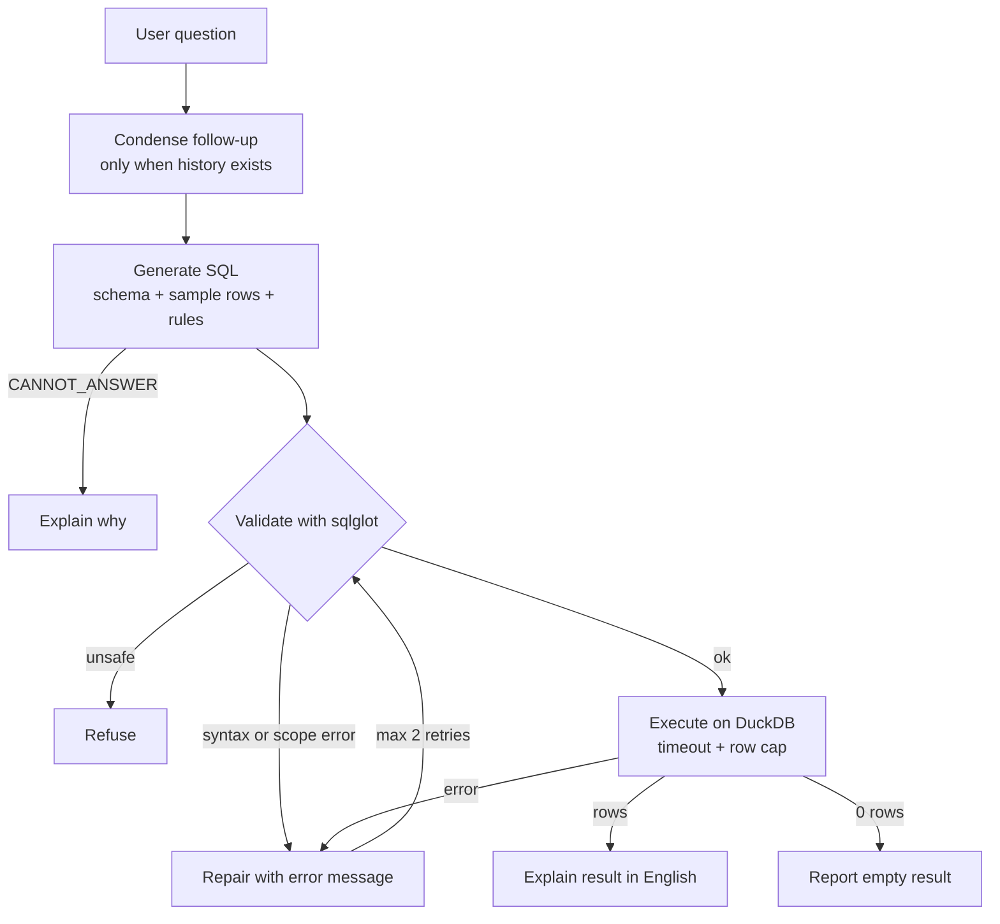

# Chinook Data Agent

A small text-to-SQL agent: ask a question about a music-store database in plain English and get an answer, the SQL behind it, the data, and a chart. The focus of the project is not the SQL generation itself but **measuring and improving reliability**: the agent is wrapped in validation, repair, and three evaluation suites.

Runs entirely on free tiers (Gemini API free tier, DuckDB, Streamlit). Cost to build and run: $0.

## What it does

- Turns a question into DuckDB SQL using the schema, 3 sample rows per table, and a short rule set.
- **Validates** every query with `sqlglot` before running it: single read-only `SELECT` only, allowed tables only, no file-reading table functions.
- **Repairs** failed queries by sending the error back to the model (max 2 retries).
- **Says no** when the data cannot answer the question (e.g. "average customer age") instead of inventing a column, and refuses write requests.
- **States assumptions** on vague questions ("best customers" → "best = highest total spend").
- **Handles follow-ups** ("and only for 2012?") by rewriting them into standalone questions first.
- Explains results in plain English, shows the SQL, and draws a chart when the result suits one.
- Logs every query (status, repairs, latency, model) to `query_log.jsonl`.
- Calls the primary model with a timeout and retries, then falls back to a second model.

## Architecture



Result statuses: `ok`, `repaired`, `empty`, `cannot_answer`, `refused`, `failed`.

No agent framework is used. The only tool is one `run_sql` function, and the control flow is a plain Python loop. For a single-tool pipeline this is simpler and easier to test than a framework.

## How it is evaluated

| Suite | Size | What it checks | Grading |
|---|---|---|---|
| `evals.json` | 25 questions (6 easy, 11 medium, 8 hard) | SQL correctness: joins, window functions, date logic, percentages, anti-joins | Result set equals the result of hand-written gold SQL (order, column names, and float noise ignored) |
| `behaviours.json` | 21 cases | Messy phrasing, unanswerable questions, unsafe requests, ambiguous questions, empty results; 4 cases held out and never tuned on | Rule-based on status and flags (e.g. "no data returned, DB unchanged") |
| `multiturn.json` | 6 conversations | Follow-ups, entity swaps, topic switches, a 3-turn chain | Final turn compared against gold SQL |

Each suite can be run several times (`--runs 3`) because model output varies even at temperature 0.

### Results

| Stage | Change | 25-question eval | Behaviour tests | Multi-turn |
|---|---|---|---|---|
| 1 | One-shot baseline (10 questions) | 8/10 | n/a | n/a |
| 2 | Added a "round money before ranking" prompt rule | 10/10 | n/a | n/a |
| 3 | Expanded to 25 questions | 25/25 (3 runs) | n/a | n/a |
| 4 | Agent loop: validate, repair, explain | 25/25 | 14/17 | n/a |
| 5 | Tightened prompt rules (unanswerable, assumptions) | 25/25 | 21/21 (incl. 4 held-out) | n/a |
| 6 | Follow-up rewrite step | 25/25 | 21/21 | 5/6, then 6/6 after fixing the answer key |

Raw run outputs are in `results/`.

## What went wrong along the way

Three of the four eval failures I investigated were **errors in my answer key, not in the model**.

1. **Over- or under-specified gold SQL (Q9, Q5, multi-turn M4).** The model's answer was correct but returned different columns than my gold query (a split first/last name, a missing count column, an extra revenue column). I kept the comparator strict and fixed the question wording or the gold SQL, so the rule is now: *gold SQL returns exactly what the question, as phrased, asks for.* A looser comparator would also have passed wrong answers.
2. **A tie lost in the results (Q9).** Three UK customers tied at 37.62 in total spend, but the model returned only two of them. I suspect floating-point noise in unrounded sums; a prompt rule to round money before ranking fixed it. I did not isolate the floating-point cause beyond that.
3. **Silent substitution (behaviour test B8).** Asked how many tracks each customer "listened to", the model answered using purchase quantities with no warning. The rule "do not approximate a concept the tables don't record" fixed it, and four held-out questions (play counts, ratings, and two ambiguous ones) were added to check the fix was not just memorising the failing tests.
4. **Non-determinism.** One query (Q10) failed with a SQL error twice and then passed after an unrelated change. This is why every suite runs with temperature 0 and can run multiple times.
5. **Latency.** Early calls hung for 3+ minutes because the SDK had no timeout and one preview model returned 504s. Fix: 30-second timeout, retry with backoff on transient errors, and a fallback model.

## Limitations

- **Small, famous database.** Chinook has 7 relevant tables and is widely known, so the model has probably seen it. Scores are likely optimistic, and the schema fits in the prompt, so schema retrieval is not exercised.
- **Small, author-written evals.** All three suites are saturated (at or near 100%), so they can no longer show improvement. They work as regression tests, not as a general accuracy claim. The held-out set is only 4 cases.
- **Behaviour grading is rule-based.** It checks status and flags, not whether the English answer is well written.
- **`sqlglot` validation is not a security boundary.** The database is attached read-only as a second layer, but a production system needs database-level roles and permissions.
- **Assumption rule is noisy.** The agent sometimes states an assumption on a question that isn't ambiguous (seen on "which 3 artists have the most albums?").
- **One model family, free tier.** Rate limits apply, and if the fallback model answers some questions, a single run mixes two models (the model used is recorded per question).
- **Single user, local.** One shared database connection; no authentication.
- **Data leaves the machine.** Schema and sample rows are sent to the model API. Free-tier inputs may be used by the provider to improve its products, so this project only uses a public sample dataset.

## Setup

1. Python 3.12 and a free Gemini API key from Google AI Studio.
2. Create and activate a virtual environment, then install dependencies:
   ```
   python -m venv .venv
   source .venv/Scripts/activate        # Windows Git Bash; use .venv\Scripts\Activate.ps1 in PowerShell
   pip install -r requirements.txt
   ```
3. Download `Chinook_Sqlite.sqlite` from the [Chinook database repository](https://github.com/lerocha/chinook-database) (check its license) and place it in the project folder.
4. Copy `.env.example` to `.env` and fill in your key and model names. Model names change; pick ones your key can use. Prefer a pinned name over a `-latest` alias for the primary model, so evals stay reproducible.

## Run

```
streamlit run app.py                                   # web UI
python agent.py                                        # command-line chat

python check_gold.py                                   # sanity-check the answer key
python run_evals.py <tag> --runs 3 --loop              # 25-question eval on the full agent loop
python run_behaviours.py <tag> --runs 3                # behaviour tests
python run_multiturn.py <tag> --runs 3                 # multi-turn tests
python inspect_fail.py <question_id> <tag>             # inspect a failing eval question
```

`<tag>` is any label you choose; results are saved as `results_<tag>.json`.

## Project layout

```
agent.py            generate -> validate -> execute -> repair -> explain loop
app.py              Streamlit UI
evals.json          25 questions with gold SQL
behaviours.json     21 behaviour cases
multiturn.json      6 multi-turn conversations
run_evals.py        eval runner (--runs, --loop)
run_behaviours.py   behaviour runner
run_multiturn.py    multi-turn runner
check_gold.py       prints gold SQL results for manual review
inspect_fail.py     shows model SQL vs expected for one failing question
results/            archived run outputs

```

## Next: advanced version

Planned next phase: LangGraph orchestration, schema retrieval over a larger multi-source database, tracing and cost dashboards, a Spider/BIRD benchmark subset with an ablation table, and Postgres with deployment and CI.